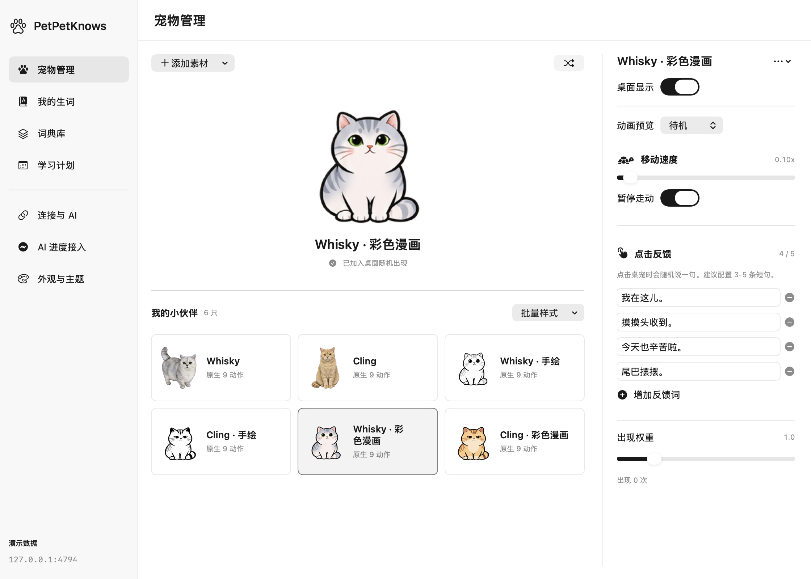
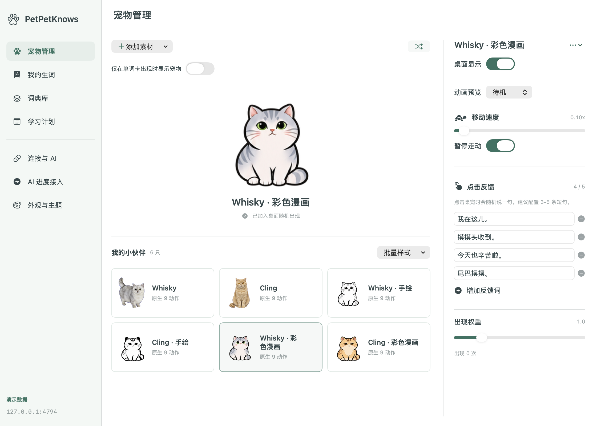
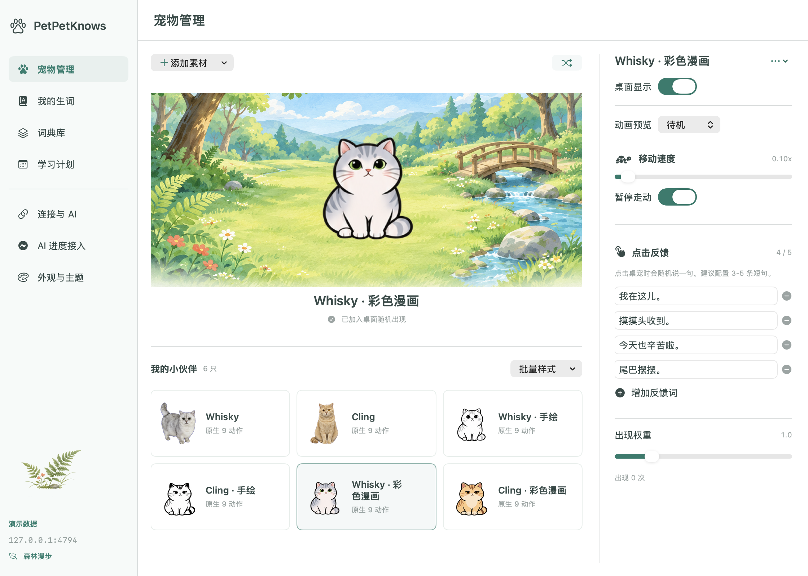
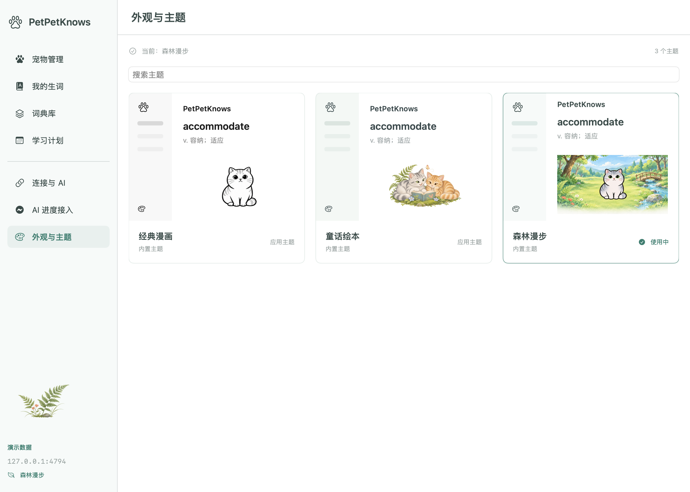
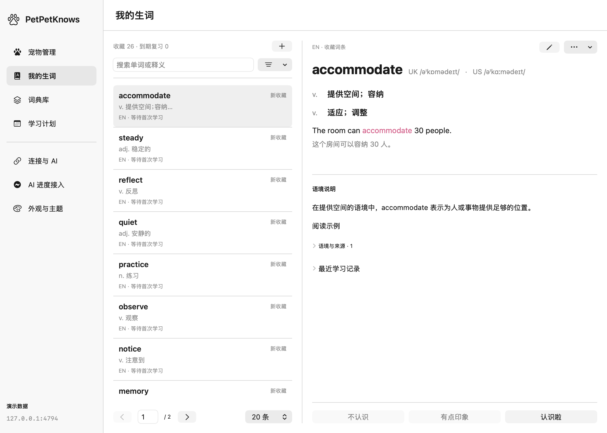
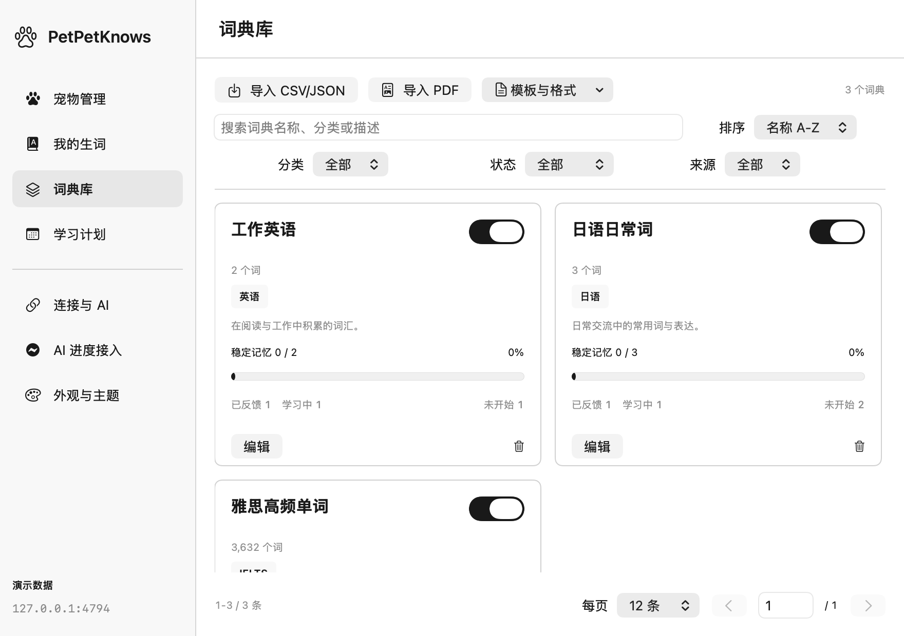
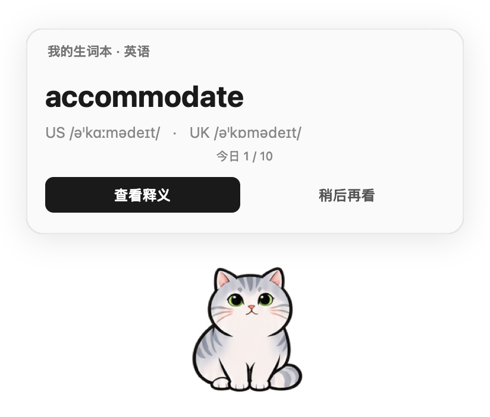
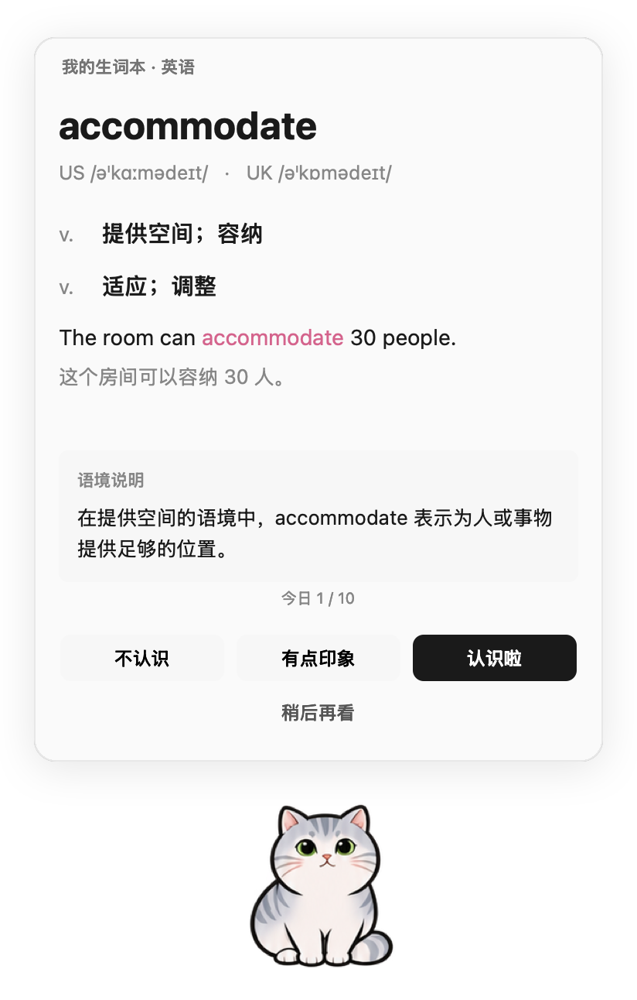
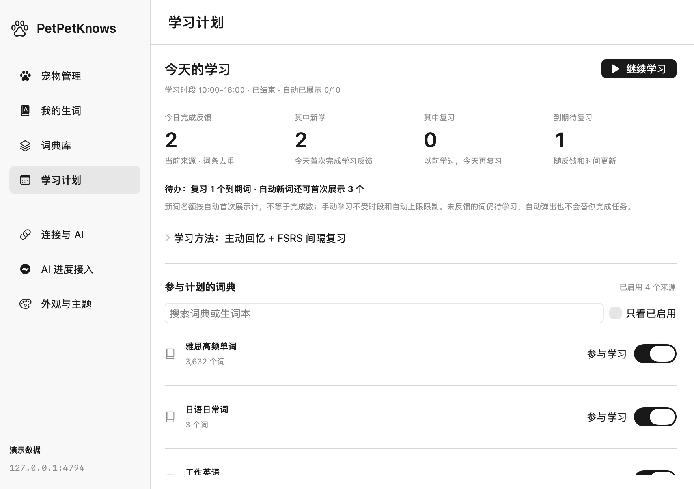
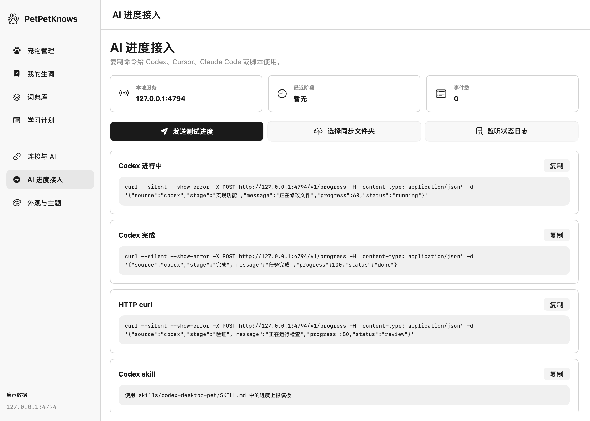

# PetPetKnows

桌面上的小伙伴，也是你的随身生词本。阅读时顺手收藏，空闲时轻轻复习，AI 工作结束时提醒你。

[下载 macOS 版](https://github.com/koeika/mac-desktop-pet-public/releases/latest) · [查看全部版本](https://github.com/koeika/mac-desktop-pet-public/releases) · [反馈问题](https://github.com/koeika/mac-desktop-pet-public/issues)

**适用于 macOS 14 及以上、Apple Silicon（M 系列芯片）。当前不提供 Intel / Windows 版。**



## 你可以用它做什么

| 你正在做的事 | PetPetKnows 带来的帮助 |
| --- | --- |
| 在 Chrome 阅读外语内容 | 选中生词，就地查看并收藏单词、音标、释义、例句和来源，不必切到另一张表单 |
| 想记住查过的词 | 在桌面复习，根据“不认识 / 有点印象 / 认识啦”安排下次出现的时间 |
| 已经有自己的词本 | 导入 CSV、JSON 或可复制文本 PDF，按语言分类，搜索、筛选和分页管理 |
| 等待 Codex 完成工作 | 接入完成后，工作进度和完成消息会显示在宠物上方 |
| 只想要安静的陪伴 | 选择彩色漫画、黑白手绘或写实形象，慢速偶尔走动，也可以完全暂停 |

## 1. 下载并运行

1. 打开 [Releases](https://github.com/koeika/mac-desktop-pet-public/releases/latest)，下载名称为 `PetPetKnows-版本号-macos-arm64.zip` 的**完整包**，不要下载 “Source code”。
2. 解压，把 `PetPetKnows.app` 放到“应用程序”文件夹，然后打开。
3. 第一次启动会打开配置中心，桌宠同时出现在桌面；以后可**右键宠物 → 配置中心**，或从菜单栏图标进入。

完整包内已有六套宠物素材、3,674 个雅思词条和 Chrome 插件，不需要安装 Swift 或自行编译。原有用户升级时只替换 App，不要删除本机数据目录。

> 当前安装包没有 Apple Developer ID 公证。只在确认下载来源可信时，按 macOS“系统设置 → 隐私与安全性”的提示操作；如果提示文件损坏或有害，请先停止打开、重新下载并检查发布页的 SHA256SUMS，不要关闭系统安全保护。参见 [Apple 官方打开应用说明](https://support.apple.com/en-us/102445)。

## 2. 选一只宠物，安静陪着你

**右键宠物 → 配置中心 → 宠物管理**：

- 点击 **彩色漫画 / 黑白手绘 / 写实原版**，预览与桌面形象同步更新。
- **上传素材**支持图片、GIF/APNG、MP4/MOV；也可导入 Codex pet 包或粘贴安装链接。
- 用 **移动速度**调整慢走节奏，最低 0.05x；开启**暂停走动**即可停在原地。闲置动作之间也会休息，不再不停左右摆动。
- **点击反馈**可设置宠物被轻点时随机说的话。
- 开启 **仅在单词卡出现时显示宠物**，平时隐藏宠物，词卡出现时再一起显示；反馈、跳过或超时关闭后自动隐藏。AI 通知仍可单独出现，不带出宠物。宠物隐藏时，可从菜单栏进入配置中心或点击“现在抽一个词”。此选项默认关闭，并在重启后保留。
- 独立的**外观与主题**页面可以搜索、预览并切换经典漫画、童话绘本和森林漫步；宠物造型和主题可以自由组合，暂不支持外部主题包导入。



**外观与主题**有独立的预览画廊，搜索主题名称后点击即可应用；选择会在重启后保留，不改变你的词库和复习进度。

**森林漫步**在宠物预览中加入手绘森林，生词阅读区仍是清爽白底。主题只改变外观，不会重置学习计划或学习记录。





日常操作只需记住：

| 操作 | 效果 |
| --- | --- |
| 左键轻点 | 宠物说一句你设置的话 |
| 左键拖动宠物 | 移动桌宠位置 |
| 右键 → 单词 | 主动复习一个词 |
| 右键 → 配置中心 | 打开设置 |
| 右键 → 暂停走动 / 继续走动 | 快速切换是否移动 |

触控板双指点按、Control + 左键也能打开右键菜单。打开或取消菜单不会突然弹出词卡。

## 3. 把网页上查过的生词留下来

### 第一次：安装并配对 Chrome 插件

1. 在 Chrome 地址栏打开 `chrome://extensions`，开启右上角**开发者模式**。
2. 点击**加载已解压的扩展程序**，选择完整包中的 `ChromeExtension` 文件夹。请把这个文件夹保存在固定位置。
3. App 中进入侧栏的**连接与 AI**，点击**复制 Chrome 配对码**。也可在这里打开 App 随附的插件文件夹。
4. 点击 Chrome 工具栏里的 PetPetKnows 插件，在配对区域粘贴配对码并保存。

配对码是插件连接本机 App 的凭证，**不是 OpenAI / DeepSeek Key，不要公开分享**。加载本地扩展的步骤也可参考 [Chrome 官方说明](https://developer.chrome.com/docs/extensions/get-started/tutorial/hello-world#load-unpacked)。

### 以后：选词 → 点小加号 → 收藏

选中网页里的单词，点击旁边的小加号，在原页面查看词条，再点击**收藏到桌宠**。收藏会出现在侧栏的**我的生词**。

可以继续搭配 Immersive Translate 使用；本插件处理你主动选中的文字，不读取它的内部翻译弹窗。没有查到完整释义时，也可以先收藏，之后再补充。

- **App 关闭时也能收藏**：插件先存到当前 Chrome 的本地队列，App 开启后重试发送。此时不是已经同步到其他设备。
- 更新插件后，请在扩展管理页重新加载，并**刷新已经打开的网页**。
- Chrome 内部页、内置 PDF 阅读器等受限页面，可尝试工具栏插件面板，不会强行打开新标签页。

## 4. 复习与词典管理



侧栏直接进入三个学习页面：

- **我的生词**：查看网页收藏；按单词、释义、网页标题搜索，按语言和学习状态筛选，查看语境与学习记录。
- **词典库**：卡片内查看稳定记忆进度、已反馈和学习中词数；支持导入 CSV / JSON / PDF，分类、改名、启用或移除词典，以及分页和跳页。
- **学习计划**：查看今日完成、新学、复习和到期任务，选择参与学习的词典；可展开学习方法，调整学习时段、自动展示次数、新词数量和最短弹出间隔。



PDF 目前只支持可复制文字的文件，扫描图片 PDF 不做 OCR。导入会先展示候选词条，确认后才保存。可只用本地解析；主动点击“用 DeepSeek 解析 PDF”时，提取出的 PDF 文本会分批发给 DeepSeek，敏感文件请不要使用该选项。CSV / JSON 模板可从**模板与格式**打开。


### 先想一下，再看答案

<table>
<tr>
<td></td>
<td></td>
</tr>
<tr><td>先回忆单词含义</td><td>点击“查看释义”后再反馈</td></tr>
</table>

- **不认识**：进入较近的重学安排。
- **有点印象**：回忆出来了，但比较费力。
- **认识啦**：更新熟练度，通常会隔更久再出现。
- **稍后再看**：延后复习，不当成答对或答错。

反馈按钮提示本次计算的下次复习间隔，词卡底部显示当前词典的有效反馈覆盖进度。实际自动弹出还会遵守你设置的学习时段、每日数量和最短间隔，不会为了补进度密集打扰你。手动右键抽词不受自动次数和时段限制，但仍需要有可学习或到期的词。

**进度怎么算？** 主进度条统计“稳定记忆”，不是弹出次数，也不是一次点“认识啦”的数量。App 使用 [FSRS 遗忘概率模型](https://docs.ankiweb.net/manual/deck-options#fsrs)安排复习，稳定记忆采用本 App 的保守规则：至少 3 次有效间隔认识反馈，相隔至少 24 小时且后续达到到期时间，跨度不少于 7 天，模型稳定度不少于 7 天，当前未到期且预计可回忆率达到你的目标保持率。早于到期的重复点击不增加有效间隔次数。

这是估计，不是“永远不会忘”的保证。遗忘、费力回忆、逾期或预计可回忆率下降后会回到学习中。“已反馈”只统计有逐次反馈记录的不同词条，回答一次会计入已反馈但不会计入稳定记忆。旧标记保留并单列待核实，不伪造复习历史；仅展示和跳过不计入稳定记忆。清理旧版无标记展示记录不会删除词条或有标记的学习记录。



## 5. 让宠物提醒 AI 工作完成

App 中进入**AI 进度接入**，先点**发送测试进度**，确认能收到提醒。



**只有打开 App，不会自动让 Codex 上报。** 使用 Codex 时，还需要安装完整包中的 skill：在解压后的完整包文件夹打开终端，运行：

```bash
bash Scripts/install-codex-skill.sh
```

安装后重启 Codex 或开启新会话，App 保持运行。任务进度、完成或失败时，宠物会临时显示通知；AI 通知优先于学习词卡。Claude Code、Cursor 等工具也可接入，但需要自行配置上报，不会自动接管它们的会话。

## 可选：补全释义、音标与例句

在**连接与 AI**中选择 OpenAI 或 DeepSeek，填写对应服务的 Key。Key 存在 macOS Keychain，不会显示成明文；两家的 Key 不可混用。

不配置 Key，也能使用已有词典、已收藏内容和本地复习。生成内容取决于你所配置的服务及额度，可能产生服务费用。英美音标和例句译文缺失时会明确提示，不会把缺失内容伪装成已有资料。

## 数据、隐私与常见问题

**词典或收藏怎么少了？**

先看配置中心左下角是**本机数据**还是**演示数据**，再检查搜索、分类、状态筛选和页码。升级不会清空本机词库。截图使用独立演示数据，不是你的个人词本。

**哪些内容可以离线使用？**

宠物素材、本地词库与学习安排都可离线使用。网页新收藏在 App 关闭时暂存于当前 Chrome；需要 AI 生成的补全仍需联网。

**会把阅读内容发出去吗？**

词条、来源和语境保存在本机。词条补全会向所选服务发送单词及少量上下文，不发送整张网页；**主动使用 DeepSeek PDF 解析则会分批发送提取的文档文本**。这两种操作的发送范围不同，敏感 PDF 请只用本地解析。

**多台设备会自动同步吗？**

目前没有开箱即用的账号云同步。可配置 iCloud Drive 学习记录文件同步，但它不包含全部宠物素材、网页收藏及语境；不要把它当成完整词本云同步。

**App 打开后看不到宠物？**

先检查菜单栏图标，选择显示宠物；配置中心确认至少有一只宠物已启用且权重大于 0。遇到启动错误，请从 [Issues](https://github.com/koeika/mac-desktop-pet-public/issues)反馈系统版本、App 版本和报错截图，不要附上 Key、配对码或个人数据。

---

[源码运行与进度 API](docs/development.md) · [MIT License](LICENSE) · [第三方素材说明](THIRD_PARTY_NOTICES.md)

自带和导入的词典、图片、动画请确认具有合法使用或分发权限。
