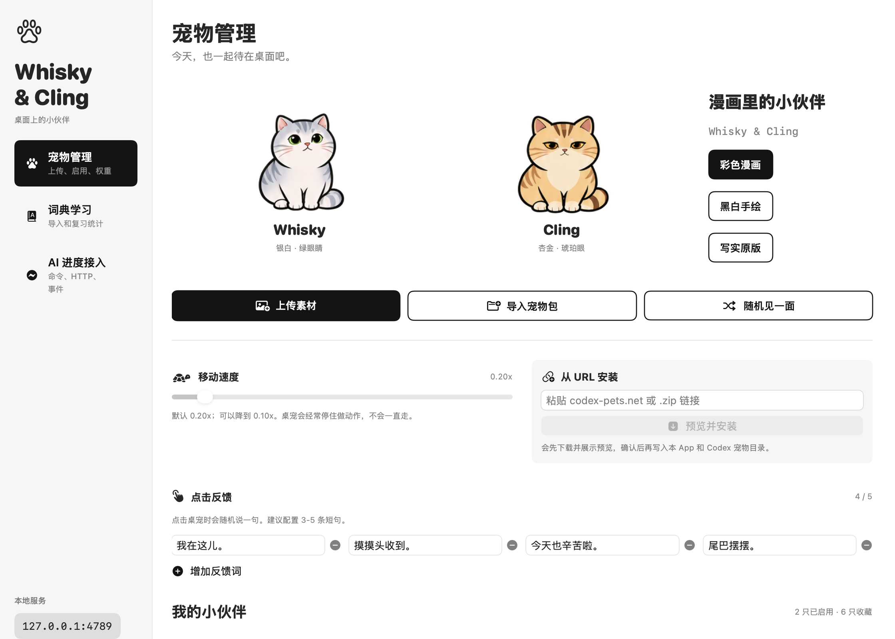
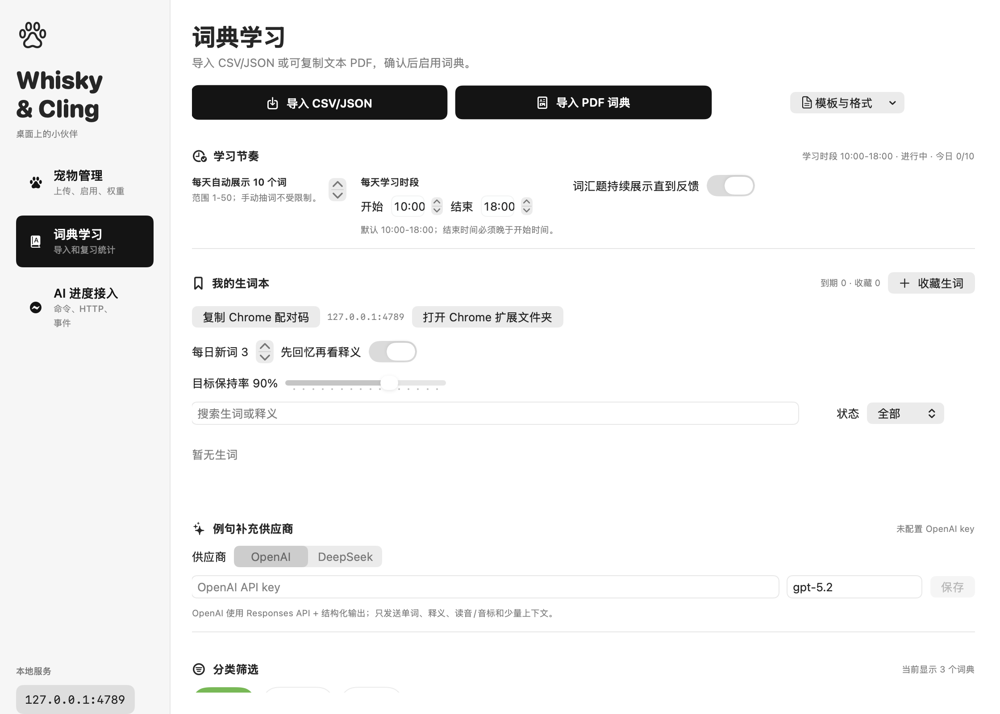
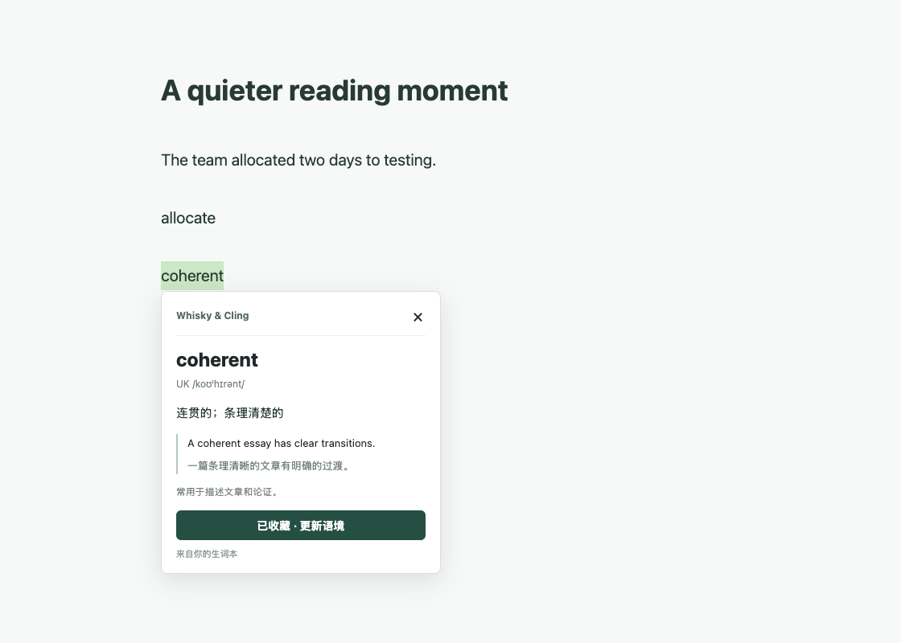

# Whisky&Cling

macOS 桌宠应用：自定义宠物素材、AI 编程进度提醒、背单词互动复习。

Native macOS desktop pet for AI coding progress and lightweight vocabulary review.



## 功能概览

- 漫画双宠：内置 Whisky / Cling 原版、黑白手绘和彩色漫画，一键切换，九动作独立预览。详见[双宠使用说明](docs/ink-companions.md)。
- 原生 macOS 桌宠：透明悬浮窗口、菜单栏控制、随机慢速走动、暂停、隐藏、锁定位置。
- 宠物素材管理：支持上传静态图片、GIF/APNG、MP4/MOV，也支持导入 Codex pet 包。
- 9 动作桌宠：Codex pet 包可使用 `idle`、`runningRight`、`runningLeft`、`waving`、`jumping`、`failed`、`waiting`、`running`、`review`。
- 照片伪动作：静态照片会用翻转、呼吸、弹跳、挥手、等待脉冲、失败抖动等程序化动作增强表现。
- 点击反馈：点击桌宠会随机说一句你配置的反馈词。
- AI 进度接入：通过 `petctl` CLI 或本地 HTTP API 上报 Codex、Claude Code、Cursor 等工具的工作进度。
- 词典学习：支持 CSV、JSON、可复制文本 PDF 导入；支持分类筛选、启用/禁用、删除、改名、统计。
- 学习节奏：可配置每天自动出现多少词、每日固定学习时段、词汇气泡是否持续显示到反馈。
- 网页生词收藏：Chrome 扩展保存单词、英美音标、释义、原句、翻译和来源链接；桌宠关闭时自动暂存。
- 记忆复习：使用开源 FSRS-6，先回忆再看释义，逐词保存反馈和下次复习时间。
- 例句与音标补全：支持 OpenAI 或 DeepSeek key，批量补例句或音标。
- 本地优先：宠物素材和设置保存在本机，API key 存 macOS Keychain。

## 下载发布包

从 [GitHub Releases](https://github.com/koeika/mac-desktop-pet-public/releases) 下载最新的 `whiskycolin-<version>-macos-arm64.zip`。

解压后可以打开 `Whisky&Cling.app`。发布包做了 ad-hoc 签名，但尚未做 Apple Developer ID 公证；如果 macOS 提示来自未认证开发者，请右键 `Whisky&Cling.app`，选择 `打开`。

zip 内也包含 `bin/petctl`，可用于向运行中的桌宠上报 AI 进度。

完整包已内置 **6 套 Whisky / Cling 九动作宠物**、**3,674 个雅思高频词（含已有音标）**、少量英日语示例词和 **ChromeExtension 插件**。首次运行无需再下载这些素材。Release 另提供独立插件 ZIP、`asset-manifest.json` 内容清单与 `SHA256SUMS`，不包含个人设置、Key、配对码或学习记录。详见[本版发布说明](docs/release-notes.md)。

## 从源码运行

```bash
git clone git@github.com:koeika/mac-desktop-pet-public.git
cd mac-desktop-pet-public
swift run whiskycolin
```

启动后会出现菜单栏应用 `Whisky&Cling`、透明桌宠窗口，以及配置中心。首次启动自动打开配置中心并添加双宠素材；升级不会覆盖已有宠物的权重和启用状态。

最低目标系统：macOS 14+。

## 配置中心

侧栏底部的 **主题样式** 可在 **经典漫画** 和 **童话绘本** 之间切换，即时更新配置中心与桌宠气泡，并在重启后保留。旧用户默认沿用经典漫画。主题与宠物造型独立：切换主题不改启用宠物、权重、词典、学习记录或浏览器配对；黑白手绘、彩色漫画和写实素材均保留。绘本双宠插画用于配置页展示，不会把上传的动画宠物替换成静态图。

查看[双主题截图与说明](docs/themes.md)。浏览器插件暂不跟随桌面主题。

从菜单栏 `Whisky&Cling` 打开 `打开配置中心...`。

### 宠物管理

这里是桌宠外观和行为的入口：

- `上传宠物素材（图片/GIF/视频）`：导入自己的宠物照片、动图或视频。
- `从 URL 安装`：粘贴 Codex pet 站点链接或直接 `.zip` 链接，先预览再安装。
- `导入本地已解压包`：导入包含 `pet.json` 和 `spritesheet.webp/png` 的宠物包文件夹。
- `移动速度`：调整桌宠走动速度，支持很慢的桌宠节奏。
- `点击反馈`：配置 3-5 条点击桌宠时随机出现的话。
- 宠物卡片：启用/禁用、出现权重、预览动作、删除素材。
- `彩色漫画` / `黑白手绘` / `写实原版`：切换 Whisky / Cling 的独立素材，保留其他宠物设置。

Codex pet 包会复制到本 App 数据目录，并同步安装到 `~/.codex/pets/<pet-id>`，方便 Codex pet 生态继续使用。

### 词典学习



这里管理背单词内容：

- `导入 CSV/JSON 词典`：导入结构化词表。
- `导入 PDF 词典`：支持可选择文本 PDF；扫描版图片 PDF v1 不做 OCR。
- `学习节奏`：设置每天自动展示词数、每日固定学习时段、气泡是否持续展示到反馈。
- `例句补充供应商`：保存 OpenAI 或 DeepSeek key，用于补例句、补音标。
- `分类筛选`：点击 `日语`、`英语`、`未分类` 等分类，只展示对应词典。
- 词典卡片：展示词数、分类、启用状态、已学/待加强/跳过统计，并支持编辑名称和删除。

CSV 字段：

```text
dictionaryName,term,reading,phonetic,meaning,example,hint,tags
```

只有 `term` 和 `meaning` 必填。`tags` 用 `|` 分隔多个标签。

PDF 导入是半自动流程：先抽取候选词条，展示可编辑预览，用户确认后才写入词典。

### AI 进度接入

这里用于让桌宠汇报 AI 工作状态：

- 查看本地服务状态和端口。
- 复制 `petctl progress`、`petctl done`、HTTP `curl` 示例。
- 点击 `发送测试进度` 验证桌宠气泡是否能收到事件。
- 选择只读状态日志文件，让桌宠监听明确授权的日志路径。

AI 进度优先级高于词汇气泡。收到 `done`、`failed`、`waiting` 等状态时会临时覆盖当前词汇卡片。

## 上报 AI 进度

普通终端 CLI 示例：

```bash
swift run petctl progress --source codex --stage "实现功能" --message "正在修改文件" --progress 60
swift run petctl done --source codex --stage "完成" --message "任务完成" --progress 100
swift run petctl message --source cursor --message "等待用户确认"
swift run petctl state
```

Codex 沙箱内建议优先用 HTTP API，避免 `swift run` 读取 SwiftPM manifest 或缓存时被权限拦截。

HTTP API：

```bash
curl --silent --show-error -X POST http://127.0.0.1:4789/v1/progress \
  -H 'content-type: application/json' \
  -d '{"source":"codex","stage":"验证","message":"正在运行测试","progress":80,"status":"review"}'
```

接口保持本地回环地址 `127.0.0.1`，默认不暴露到局域网。

## Codex 自动上报

仓库内提供两个模板：

- `AGENTS.codex-pet.md`：适合复制到自己的 Codex 指令中。
- `skills/codex-desktop-pet/SKILL.md`：适合安装为 Codex skill。

如果是从 GitHub Release 下载的 zip，解压后先运行：

```bash
./Scripts/install-codex-skill.sh
```

只打开 `Whisky&Cling.app` 不会让 Codex 自动上报。安装 skill 并重启 Codex 或开启新会话后，Codex 才会在进度节点和会话完成时主动通知桌宠。

默认使用本地 HTTP API，不需要配置本机源码路径。只有修改了端口时才需要设置环境变量：

```bash
export PET_SERVER_URL=http://127.0.0.1:4789
```

## 词汇反馈规则

- 默认先显示单词和音标，点击 `查看释义` 后再根据刚才是否回忆出来反馈。
- `不认识`：FSRS Again，进入重新学习；默认短期重学步骤为 10 分钟。
- `有点印象`：FSRS Hard，表示回忆成功但费力，完全想不起来请选“不认识”。
- `认识啦`：FSRS Good，更新记忆状态与下次复习时间。
- `稍后再看`：延后一天，不把此次展示当成答对或答错，不训练 FSRS。
- 反馈后关闭气泡；按钮提示和气泡底部显示计算出的复习间隔。

自动词汇出现频率受 `每天自动展示词数` 和每日固定学习时段控制；默认学习时段为 `10:00-18:00`，不支持跨午夜。手动抽词不受每日自动上限和学习时段限制。

## 网页收藏与复习

FSRS 的到期时间表示“可以复习的时间”，实际弹出还受学习时段、每日展示上限、AI 进度和冷却影响。达到上限时顺延，不集中补弹。默认每天引入最多 3 个新词，优先复习到期词，每四次展示为新词保留一次机会。目标保持率默认 90%，可在配置中心设为 80%-95%，它是模型目标而不是效果保证。

### Chrome 收藏与沉浸式翻译

1. 解压完整发布包，在 Chrome 打开 `chrome://extensions`，开启开发者模式。
2. 点击“加载已解压的扩展程序”，选择 `ChromeExtension` 文件夹。请把文件夹放在固定位置。
3. 桌宠配置中心 -> 词典学习 -> 我的生词本，点击“复制 Chrome 配对码”。
4. 点击 Chrome 扩展图标，在“桌宠配对与自动补全”里粘贴配对码并保存；修改端口时同步修改服务地址。
5. 网页选词后会在旁边出现珊瑚色 `+` 按钮，点击就地查看释义，再点“收藏到桌宠”。不会新建标签页。



可继续同时使用 Immersive Translate。桌宠插件不读取或修改它的内部浮层，只处理你主动选中的单词和当前句子。优先查询本地词典；在插件面板开启 DeepSeek 自动补全后，点击查询时才补全缺失释义、音标、例句和中文译文，Key 仅保留在 Mac Keychain。不会上传整页、来源网址或网页标题。未开启补全或服务失败时也能先收藏，不会要求填一整张表单。

更新插件后需要在 Chrome 扩展管理页重新加载，并刷新正在阅读的网页。页内选词需要当前网站的访问权限；Chrome 内部页面和内置 PDF 阅读器等受限页面可使用工具栏的小面板，不会强行新开标签页。

桌面词卡查看释义前后保持相同外框与位置，长内容可在卡内滚动。CSV/JSON 支持 `exampleTranslation` 字段；旧词典缺失译文时会在展示释义后通过已配置的 DeepSeek 按需补全并缓存，不会批量上传整个词本。无法补译时保留原文并显示缺失状态，不编造译文。

桌宠不在线时收藏保存在 Chrome 本地队列，每两分钟重试，也可以手动重试。配对失败或字段不合法会提示错误，不显示假成功。重复收藏同语言、同拼写词条会补充语境，保留原熟练度。配置中心支持搜索、按状态筛选、编辑、删除、查看语境和复习记录。

### 旧数据迁移

已有词典与学习记录继续保留，首次写入 FSRS 反馈前备份为 `learning-progress.pre-fsrs.json`。旧版本只有累计计数，无法重建逐次复习历史，因此不会编造历史；旧“已认识”词按旧操作时间加 7 天安排首次复习，其他已反馈词进入待复习队列，后续使用真实反馈建立 FSRS 状态。启用 iCloud 学习记录同步时，各设备请使用同一新版 App；收藏词条与网页语境目前保存在本机，不包含在原有学习进度同步文件中。

算法实现参考 [swift-fsrs](https://github.com/open-spaced-repetition/swift-fsrs)，固定使用 6.0.0 版本。FSRS 调度在本地运行，不需要 API key；当前使用默认模型参数，未加入个人参数训练。

## 数据与隐私

- 宠物素材、设置、词典数据保存在本机 Application Support 目录。
- OpenAI/DeepSeek key 存 macOS Keychain，不写入 `settings.json`。
- PDF 例句生成只发送词条、释义、读音/音标和少量上下文，不上传整本 PDF。
- iCloud Drive 同步只写学习记录文件，不依赖 Apple Developer 或 CloudKit。
- 本仓库不应包含本机绝对路径、API key、token、私有日志或个人文件。

## 测试

```bash
swift build
swift run codex-pet-selftest
```

自测覆盖词典解析、PDF 草稿、学习频率、状态事件、宠物选择、气泡策略和 key 不落盘等核心逻辑。

## 发布给别人使用

推送 `v*` tag 会触发 `.github/workflows/release.yml`，自动构建并发布 macOS zip 包。

```bash
git tag v0.1.0
git push origin v0.1.0
```

当前自动发布包包含 `.app` 和 `petctl`，但没有 Developer ID 公证。要做完全正常的双击安装体验，后续还需要 Apple Developer 账号、Developer ID 签名、公证和 DMG。

## 合法内容说明

完整词典和宠物素材请确保拥有使用和分发权限。仓库可以包含你自己整理并有权发布的词表；第三方教材、商业词典或素材包不建议直接公开提交。
