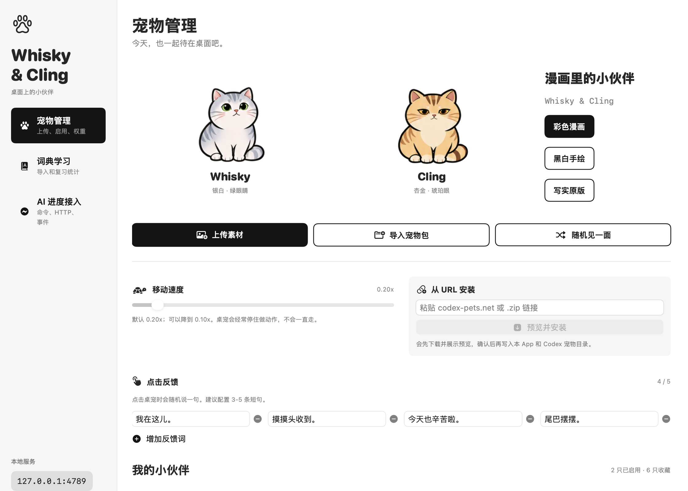
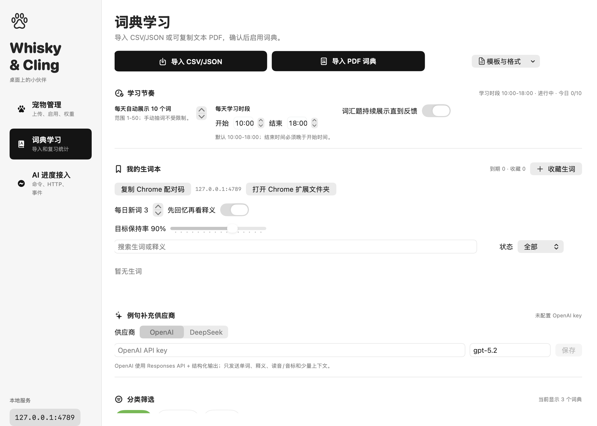
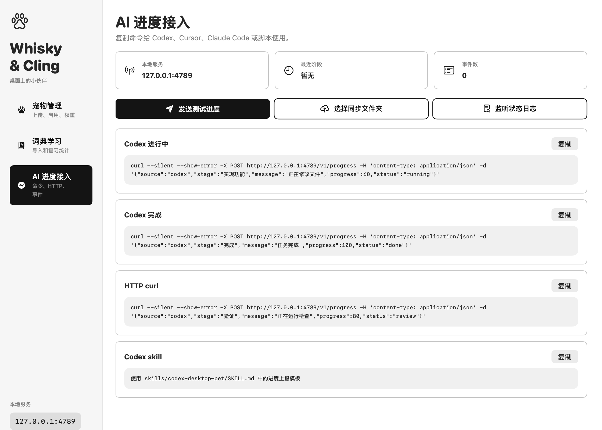

# 黑白手绘双宠

配置中心的「宠物管理」提供 Whisky / Cling 的写实原版、黑白手绘和彩色漫画版。

- **彩色漫画**：启用银白绿眼的 Whisky 与杏金琥珀眼的 Cling。
- **黑白手绘**：启用黑白双宠。
- **写实原版**：启用两只原版。
- 其他上传的宠物不受切换影响，可在下方单独关闭或调整权重。
- 卡片的「预览动作」可选择九种动作，预览只循环当前动作。
- 桌面行为仍随机闲逛、停顿并做动作，播放速度保持约 6.25fps。
- 首次安装自动添加素材；升级保留已有启用状态、权重与出现次数。
- 删除内置宠物后不会在重启时自动恢复；点击上方风格按钮可重新添加。

界面参考用户提供的黑白漫画示例，采用白底、墨色描边、黑色主按钮和紧凑
对话气泡。图片来自用户提供的宠物包；手绘版为 AI 辅助创作，不是对其他
角色原画的复制。原版链接与动画布局记录在素材目录的 README 中。

