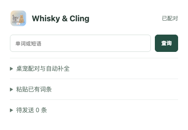
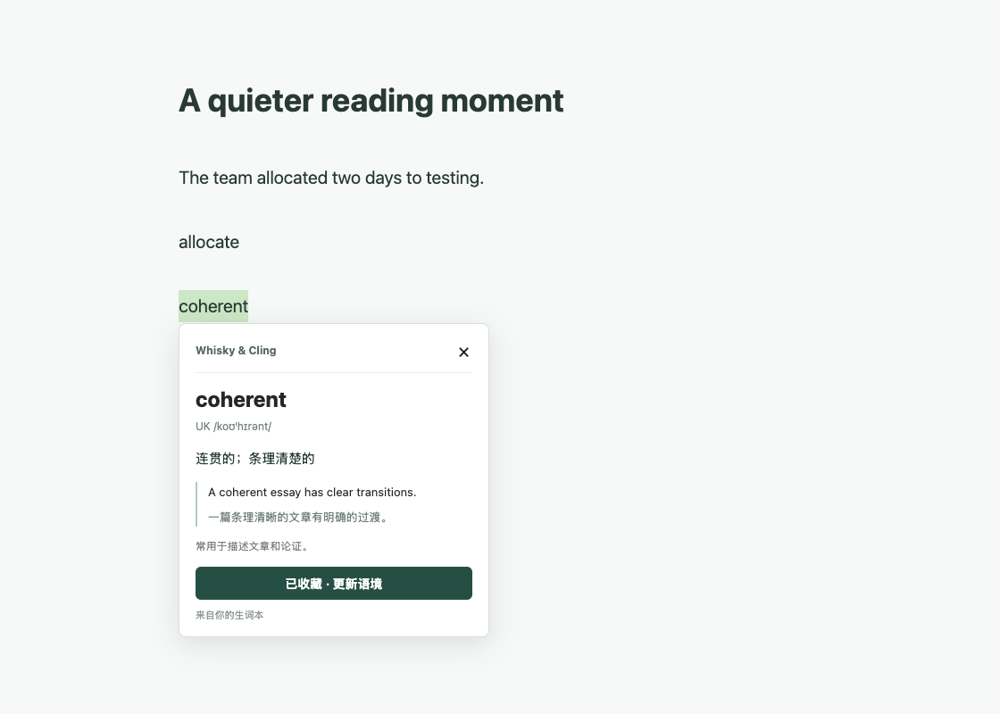
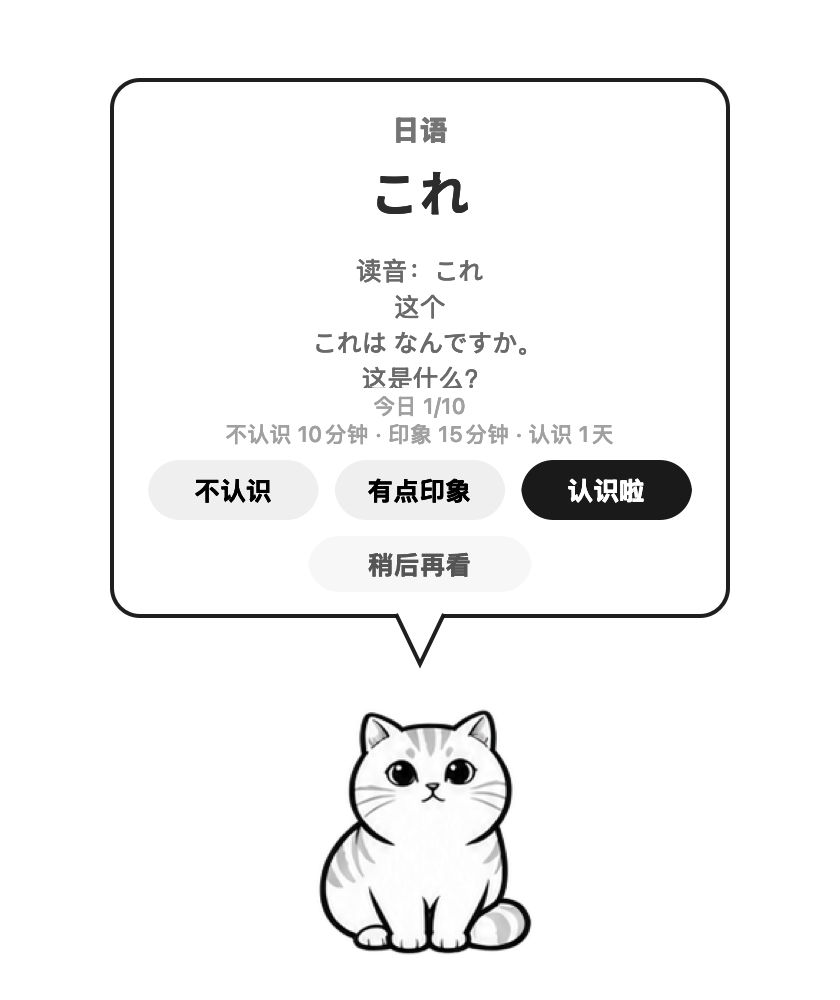

# 不离开阅读的生词收藏

## 交互约束

- 划词只显示小入口，不发查询、不自动收藏、不创建标签页。
- 点击后在选词旁显示轻量词卡，释义、音标与双语例句优先来自本地。
- DeepSeek 补全需要首次明确开启；只发送单词、释义和至多 500 字的当前句子。
- 收藏、成功和离线暂存都在原位反馈。点击空白处或 Escape 关闭。
- 页内使用封闭 Shadow DOM，不把配对码暴露给网页；伪造点击不能发起操作。
- 断网队列保留不同语境，模型出错不阻断原词条送达。

## 插件尺寸

- 选词入口的可见圆点为 20px，点击区域为 24px；加号独立几何居中，不受网页字体和浏览器默认按钮内边距影响。
- 工具栏弹窗根元素固定 380px，不使用依赖弹窗自身视口的 `max-width: 100vw`，避免 Chrome 自动尺寸计算把它压成细条。
- 展开配对、粘贴词条后仍保持相同宽度；内容区域最高 580px，过长时内部纵向滚动。
- 验证使用真正的 Chrome 工具栏 action popup，而不只是把 `capture.html` 当普通网页打开。

## 自动补全失败时

DeepSeek 官方服务使用 `https://api.deepseek.com` 和 `deepseek-flash`。旧默认模型 `deepseek-chat` 已停用；App 会仅对官方地址迁移这个旧默认值，自定义模型和第三方地址不受影响。

补全失败不会清空本地释义、原句和来源，仍可收藏并稍后重试。提示会显示明确 HTTP 状态，不向网页转发供应商原始错误正文或 Key：

- HTTP 401：Key 鉴权失败。在配置中心更新 DeepSeek API Key，不是 Chrome 配对码。
- HTTP 402：DeepSeek API 账户余额不足。
- HTTP 404：接口或模型不存在。
- HTTP 429：请求频率受限。
- HTTP 5xx：供应商服务异常。

同一个词点击查询重试会保留原文语境；更换单词才开始新的草稿。Key 仍只保存在 Mac Keychain。

参考：[官方模型说明](https://api-docs.deepseek.com/)、[旧模型停用公告](https://api-docs.deepseek.com/news/news260424/)、[错误码说明](https://api-docs.deepseek.com/quick_start/error_codes/)。

## 桌面词卡

单词、读音、正文、操作区共用同一中轴。初始两个按钮并排；展示答案后为
三档反馈，跳过居中。一个词的外框尺寸在提示、答案、译文补全之间保持不变。
过长正文内部滚动，不扩大到遮住桌面。焦点提示不再继承系统的绿色描边，
侧栏仍可通过键盘聚焦。

气泡显示时暂停位置移动，动画继续；关闭气泡后恢复慢走，按钮不会躲着鼠标。

## 视觉参考

- 沉浸式翻译的就地处理和按用户动作触发原则：
  https://immersivetranslate.com/en/docs/usage/
- 用户给出的黑白漫画界面：
  https://www.pinterest.com/pin/451908143874759359/
  该链接当前无法直接读取，使用用户附图确认布局，不声称复刻页面。
- 彩色插画方向检索：
  https://in.pinterest.com/pin/851602610825928247/
  只参考柔和彩色、清晰轮廓与圆润比例，宠物素材为自有双宠的 AI 辅助改绘，
  不直接下载或复制别人的角色作为应用资产。

Chrome 浮层用白底、低饱和绿和珊瑚入口，与彩色双宠对应；Mac 配置中心保留
黑白主结构，彩色集中在宠物本身。原版、黑白、彩色是三个独立可切换素材组。
