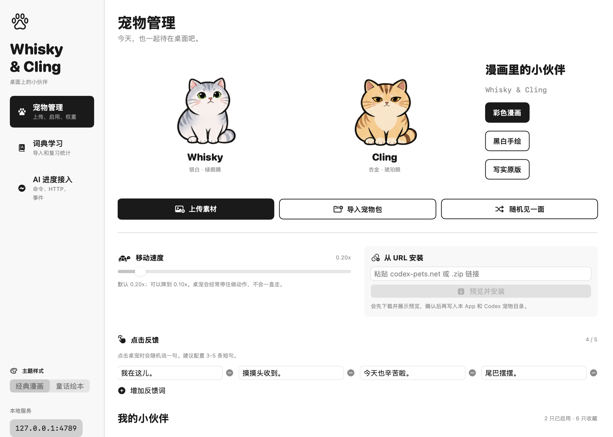
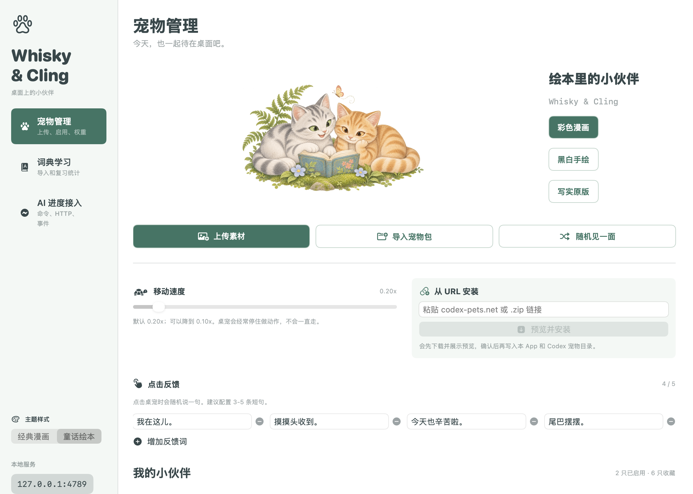

# 主题样式

配置中心侧栏底部提供两个主题，无需重启：

- **经典漫画**：保留原来的黑白界面、墨色描边和漫画双宠预览。
- **童话绘本**：白底、叶绿主色、珊瑚与浅蓝辅助色，搭配原创双宠绘本插画和轻手绘气泡边线。

切换会更新三个配置页面和当前桌宠气泡，保存到本地设置；再次启动后仍保持选择。旧用户默认经典漫画。无法保存时提示错误，不假装切换成功。

主题只改变界面外观，不改变已启用宠物、出现权重、词典、学习记录、API key 或 Chrome 配对。桌宠造型仍在宠物管理中独立选择，上传素材不会被替换。绘本双宠图是配置页插画，不是新增的九动作动画宠物包。浏览器扩展本次不随桌面主题切换。

## 界面预览

以下为原生配置窗口的测试数据截图。

### 经典漫画



### 童话绘本



## 插画来源

使用内置图像生成工具创作，文件为 `Sources/CodexPetApp/Resources/Themes/storybook-duo.png`。没有复制参考作品的角色或界面。

生成提示词：

```text
Use case: illustration-story. Asset type: original desktop companion settings illustration, wide landscape horizontal composition with transparent background. Create a charming hand-painted children's storybook scene featuring exactly two pet cats reading one open little book together on a small mossy forest patch: left cat Whisky is silver white with a few cool gray tabby marks and sage green eyes, right cat Cling is soft apricot golden tabby with amber eyes. Both friendly, rounded but natural cat anatomy, delicate slightly wobbly charcoal pencil outlines, visible subtle gouache and colored-pencil texture, not glossy vector, not anime, not 3D. Palette fresh leaf greens, sky blue accents, soft coral flowers, warm gold cat; clean white highlights. Only a little cluster of fern leaves, two simple pale blue flowers and tiny butterfly framing the cats, no huge background tree, no backdrop rectangle. Entire cats, tails, book, foliage fully visible, generous transparent margins. Visually polished modern picture-book editorial illustration, gentle playful expression, calm cozy storybook mood. No text, no typography, no watermark, no UI, no panels, no checkerboard painted into the image. True alpha outside the compact illustration.
```
